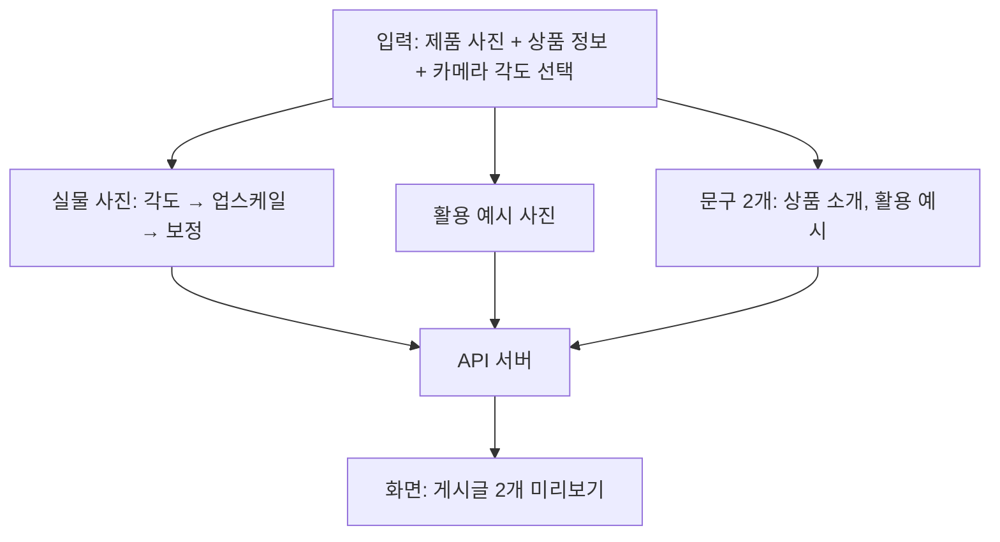

# 우리 가게 SNS: 소상공인 인스타그램 게시글 생성 서비스 (가제)

소상공인이 제품 사진 한 장과 상품 정보를 넣으면, 인스타그램에 올릴 게시글 2개(실물 소개, 활용 예시)의 사진과 문구를 만들어 주는 서비스입니다.

> Codeit AI Engineer Bootcamp 13기 고급 프로젝트 (1팀)  
> Project Period: **2026.11.19 ~ 2026.12.18**

## 📌 Project Overview

- 대상: 광고와 콘텐츠 제작이 어렵거나 생소한 소상공인
- 목표: 디자인과 글쓰기 경험이 없어도 SNS 게시글을 올릴 수 있게 한다
- 메인 기능: 제품 사진과 상품 정보(품목, 단위, 가격, 활용 예시)를 넣으면 게시글 2개가 나온다
  - 실물 소개: 원본 제품을 보존한 채 각도, 해상도, 색감을 다듬은 사진과 소개 문구
  - 활용 예시: 제품을 쓰는 장면을 연출한 사진과 활용 문구
- 다음 단계: 인스타그램 비즈니스 계정 연결, 가게 프로필(사진, 소개글) 만들기

### 서비스 흐름



## 👥 Team

| Name | Role | GitHub | 협업 일지 |
| --- | --- | --- | --- |
| 이원영 | PM (기획, 일정, 문서, 테스트) | [@1young-codes](https://github.com/1young-codes) | [원영님 협업일지](https://docs.google.com/document/d/1unQFx06byuoRJ_OBuQfDLzCAtA95AdPUmt40sE_25mc/edit?tab=t.ki2tnxupzl55) |
| 권유진 | 모델 개발 (문구 생성) | [@eugene527](https://github.com/eugene527) | [유진님 협업일지](https://docs.google.com/document/d/1unQFx06byuoRJ_OBuQfDLzCAtA95AdPUmt40sE_25mc/edit?tab=t.txte2sa0ikx) |
| 김민기 | 모델 개발 (이미지 생성) | [@LittleBitAI](https://github.com/LittleBitAI) | [민기님 협업일지](https://docs.google.com/document/d/1unQFx06byuoRJ_OBuQfDLzCAtA95AdPUmt40sE_25mc/edit?tab=t.ij7ou9e1jpjb) |
| 나상훈 | 모델 서빙, 평가 (VM, Docker, API) | [@Na-SangHun](https://github.com/Na-SangHun) | [상훈님 협업일지](https://docs.google.com/document/d/1unQFx06byuoRJ_OBuQfDLzCAtA95AdPUmt40sE_25mc/edit?tab=t.ugq6nwqqcb0y) |
| 박단비 | 서비스 개발 (화면) | [@DBDBDEEP02](https://github.com/DBDBDEEP02) | [단비님 협업일지](https://docs.google.com/document/d/1unQFx06byuoRJ_OBuQfDLzCAtA95AdPUmt40sE_25mc/edit?tab=t.f8aooc7qr42y) |

### 회의록 및 일정

- [데일리 스크럼 기록](https://docs.google.com/document/d/1unQFx06byuoRJ_OBuQfDLzCAtA95AdPUmt40sE_25mc/edit?tab=t.2qqo9r9i612o)
- [Jira 보드](https://wonyounglee226.atlassian.net/jira/software/projects/AD/boards/1)

| 스프린트 | 기간 | 목표 |
| --- | --- | --- |
| 1 | 11/20 ~ 11/23 | 주제 확정과 개발 환경 준비 (완료) |
| 2 | 11/24 ~ 12/4 | 핵심 기능 하나가 끝까지 동작한다 |
| 3 | 12/7 ~ 12/11 | 화면과 API 연결, 품질 평가 |
| 4 | 12/14 ~ 12/17 | 기능 동결, 보고서와 발표 준비 |

## 🗂️ Project Structure

```text
sprint13-last-project/
├── frontend/                       # 화면. app.py는 결과 확인용 임시 화면
├── models/
│   └── generative_ai/              # 생성형 AI 기능. 기능마다 폴더 하나, 그 안 tests/에 검증 코드
│       ├── camera_angle_presets/   # 카메라 각도 바꾸기
│       ├── fast_image_generation/  # 이미지 생성 모델 불러오기와 속도 개선
│       ├── upscales/               # 사진 키우기
│       └── llm/                    # 상품 소개, 활용 예시 문구 생성
├── serving/                        # 모델 결과를 화면에 잇는 코드
├── docs/                           # 결과 파일 형식, PR 전후 이미지
├── Dockerfile
├── docker-compose.yml              # 시연용 실행 환경
├── requirements.txt
├── requirements-gpu.txt            # GPU 환경에서 쓰는 라이브러리
├── .env.example                    # 필요한 설정 이름만 적은 견본
├── AGENTS.md, CLAUDE.md, .agent-git/   # AI 코딩 도구가 따르는 작업 규칙
└── README.md
```

모델 가중치, 데이터, 생성 결과물, `.env`는 Git에 올리지 않습니다. 이 파일들은 팀 VM의 공용 폴더에 둡니다.

| VM 경로 | 내용 |
| --- | --- |
| `/data/models` | 내려받은 모델 |
| `/data/venv` | 공용 파이썬 환경 |
| `/data/venvs/기능이름` | 공용 환경과 버전이 달라야 하는 기능의 환경 |
| `/data/datasets` | 입력 사진 |
| `/data/outputs/기능이름` | 기능별 결과 |
| `/data/outputs/demo` | 임시 화면이 읽는 결과. 형식은 [docs/result-format.md](docs/result-format.md) |

## 🛠️ Development Environment

| Category | Stack |
| --- | --- |
| Language | Python, JavaScript |
| Image Model | Qwen-Image 2.1 (각도 바꾸기), PixRestore XL (업스케일) |
| Text Model | OpenAI API (gpt-5-mini) |
| Framework | PyTorch, Diffusers, FastAPI (예정), React |
| Environment | GCP VM (g2-standard-4, NVIDIA L4), Docker |
| Project Management | Jira |
| Version Control | Git, GitHub |

## 🌿 Branch Rule

- `main`: 항상 실행 가능한 안정 버전. `dev`에서 통합 PR로만 갱신합니다.
- `dev`: 기능을 모아 확인하는 브랜치. 작업 브랜치는 `dev`에서 만들고 `dev`로 PR을 올립니다.
- 작업 브랜치: `유형/작업명` (예: `feature/upload-api`)
- 커밋: `유형: 변경 내용` (예: `feature: AD-12 업로드 엔드포인트 추가`)
- PR은 팀원 한 명의 승인을 받은 뒤 합칩니다. 카드 하나에 PR 하나를 원칙으로 합니다.

자세한 규칙은 [깃 가이드](https://docs.google.com/document/d/1unQFx06byuoRJ_OBuQfDLzCAtA95AdPUmt40sE_25mc/edit?tab=t.on1kv9xdkp27)와 `.agent-git/README.md`를 봅니다.

## 🏆 Results

<!-- 최종 결과물 예시 이미지와 평가 결과를 적습니다. -->

## ⚠️ 알려진 한계

- Qwen-Image 2.1은 비상업 연구용 라이선스입니다. 실제 서비스로 내려면 별도 라이선스나 다른 모델이 필요합니다.
- 인스타그램에 실제로 게시하려면 Meta의 앱 심사가 필요합니다. 시연은 팀이 관리하는 계정으로 진행할 예정입니다.
- 사진 한 장을 끝까지 만드는 데 수 분이 걸립니다. 모델을 미리 띄워 두는 방식으로 줄일 계획입니다.

## 📎 Reports

- 보고서 PDF: (제출 전 추가)
- 발표 자료: (제출 전 추가)
